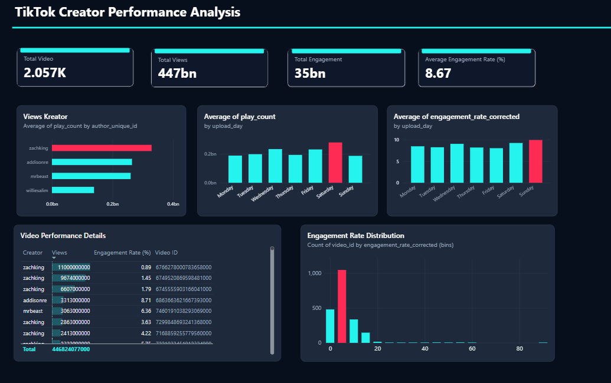

# TikTok Marketing Performance Analysis

## Project Overview

This project analyzes TikTok video performance to identify content engagement patterns, creator performance, and audience interaction trends.

Using Python, SQL, and Power BI, the project examines video views, likes, comments, shares, saves, and engagement rates to uncover performance patterns and generate actionable insights.

## Project Objectives

- Evaluate overall TikTok video performance.
- Identify creators with the highest average views and engagement rates.
- Analyze video performance across different days of the week.
- Examine audience engagement patterns through likes, comments, shares, and saves.
- Develop an interactive Power BI dashboard to visualize performance metrics and communicate key findings.

## Dataset Description

The dataset was obtained from Hugging Face: `datahiveai/Tiktok-Videos`.

Dataset overview:
- Total records after cleaning: 2,057 videos.
- Number of original columns: 14.
- Content: TikTok video metrics, creator information, descriptions, upload timestamps, and location data.

Key attributes include:
- `author_unique_id`
- `play_count`
- `digg_count`
- `comment_count`
- `share_count`
- `collect_count`
- `duration`
- `create_time`
- `location_created`

## Tools & Technologies

- **Python:** Data cleaning, exploratory data analysis (EDA), and feature engineering.
- **Pandas:** Data manipulation and analysis.
- **SQLite:** Data storage and SQL-based analysis.
- **SQL:** Data aggregation and performance analysis.
- **Power BI:** Interactive dashboard and data visualization.
- **Google Colab:** Python development environment.

## Data Cleaning & Preparation

The following data preparation steps were performed:

- Removed 3 records with missing core engagement metrics, resulting in 2,057 valid records.
- Checked duplicate records based on video URLs and video IDs; no duplicates were found.
- Handled invalid video duration values by replacing zero-duration values with missing values.
- Filled missing video descriptions with "No Caption" and missing location values with "Unknown".
- Converted upload timestamps into datetime format and extracted date-related features.
- Created additional engagement metrics, including total engagement, engagement rate, like rate, comment rate, share rate, and save rate.

## Key Metrics

**Total Engagement**

Likes + Comments + Shares + Saves

Represents the total number of interactions received by each video.

**Engagement Rate (ER)**

(Total Engagement / Video Views) × 100%

Measures the percentage of video views that resulted in interactions.

**Additional Metrics**

- **Like Rate:** (Likes / Video Views) × 100%
- **Comment Rate:** (Comments / Video Views) × 100%
- **Share Rate:** (Shares / Video Views) × 100%
- **Save Rate:** (Saves / Video Views) × 100%

## Exploratory Data Analysis

The analysis covered:

1. Overall Video Performance
2. Creator Performance Analysis
3. Average Views by Upload Day
4. Average Engagement Rate by Upload Day
5. Engagement Rate Distribution

## Key Findings

- The dataset contains 2,057 TikTok videos after data cleaning.
- Total video views reached approximately 44.68 billion.
- Total engagement reached approximately 3.46 billion interactions.
- Average engagement rate was approximately 8.67%.
- Zach King recorded the highest average views among the four creators analyzed.
- MrBeast recorded the highest average engagement rate.
- Willie Salim contributed the highest number of videos in the dataset.
- Saturday recorded the highest average video views.
- Sunday recorded the highest average engagement rate.

These findings describe the analyzed dataset and should not be interpreted as universal TikTok performance patterns.

## Power BI Dashboard

The dashboard presents key performance indicators, creator comparisons, upload-day performance, and engagement rate distribution.



## Repository Structure

```text
tiktok-marketing-performance-analysis/
│
├── data/
│   ├── .gitkeep
│   └── tiktok_marketing_clean.csv
│
├── dashboard/
│   ├── .gitkeep
│   └── TikTok_Marketing_Performance_Dashboard.pbix
│
├── notebooks/
│   └── Tiktok_Marketing.ipynb
│
├── sql/
│   ├── .gitkeep
│   └── tiktok_analysis.sql
│
├── visualizations/
│   └── tiktok_dashboard_overview.png
│
└── README.md
```

## Project Files

- **Cleaned Dataset:** Contains the cleaned TikTok video dataset used for analysis.
- **Python Notebook:** Contains data cleaning, exploratory data analysis, and feature engineering.
- **SQL Queries:** Contains SQL queries for TikTok performance analysis.
- **Power BI Dashboard:** Interactive visualization of TikTok video performance.
- **Visualizations:** Dashboard screenshot.

## Conclusion

This project demonstrates the use of Python, SQL, and Power BI to analyze social media performance data and transform raw data into meaningful insights.

It highlights my ability to perform data preparation, exploratory analysis, SQL querying, and dashboard development.
